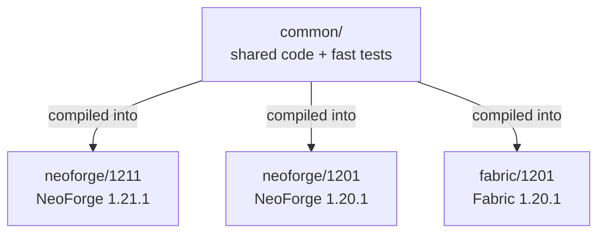

# Create Photomovement — Architecture Documentation (arc42)

Status: 2026-11-16, mod version 0.4.0.

This document describes **how the project is structured and why**. It follows the
structure of [arc42](https://arc42.org), but is deliberately kept short: a chapter that
has nothing to say for a mod of this size consists of a single sentence.

What is **not** in here:

| Topic | Found in |
|---|---|
| What the mod does for players | [README.md](../../README.md) |
| What changed from version to version | [CHANGELOG.md](../../CHANGELOG.md) |
| Fixed bugs and their causes | [docs/bugs.md](../bugs.md) |
| Current work status, notes, knowledge collection | [docs/Current-Dev-Status.md](../Current-Dev-Status.md) |
| Structure and status of the in-game tests | [docs/gametests.md](../gametests.md), [docs/test-world.md](../test-world.md) |

---

## 1. Introduction and Goals

Create Photomovement is an addon for the Minecraft mod **Create**. It adds rotational
power sources driven by the sun: four types of solar generators and a windmill bearing
with solar sails.

The most important goals, in this order:

1. **Same behavior on all targets.** A generator should deliver the same rotation speed
   on NeoForge 1.21.1, NeoForge 1.20.1 and Fabric 1.20.1.
2. **Maintainable by one person.** The project is maintained by a single author.
   Errors should surface early and be understandable, not only in the game.
3. **Close to Create.** The blocks should feel like Create blocks (Ponder scenes,
   stress display, coloring).

## 2. Constraints

| Constraint | Impact |
|---|---|
| Three targets: NeoForge 1.21.1, NeoForge 1.20.1, Fabric 1.20.1 | Each target is its own Gradle project with its own build plugin. |
| Two Java versions: 21 for 1.21.1, 17 for 1.20.1 | Both JDKs must be installed on the development machine and in CI. |
| Create version differs per target: 6.0.10 (1.21.1), 6.0.8 (NeoForge 1.20.1), 6.0.8.1 (Fabric) | Create classes are sometimes named differently or have different methods. |
| Minecraft changed methods and folder names between 1.20.1 and 1.21.1 | Some classes and all data folders (`recipe` vs. `recipes`, etc.) exist per version. |
| License MIT | No restriction on the structure. |

The exact version numbers are in the `gradle.properties` of the targets, not here.

## 3. Context and Scope

The mod runs inside the game and depends on these external building blocks:

| Neighbor | Purpose |
|---|---|
| Minecraft + loader (NeoForge / Fabric) | Starts the mod, provides blocks, world, weather, time of day. |
| Create | The rotational power system (speed, stress), windmill bearing, sails, config foundation. |
| Registrate | Registers the blocks and items with the game. |
| Flywheel | Draws the rotating parts. |
| Ponder | The explanation scenes in the game. |
| Forge Config API Port (Fabric only) | Makes the Forge config files usable under Fabric. |

Externally, the project delivers three jar files, one per target.

## 4. Solution Strategy

- **Separate calculation from Minecraft.** The actual logic ("how much rotation speed at
  this time of day and this weather?") lives in classes with no Minecraft dependency at
  all (`common/.../logic`). They can be tested in seconds without starting the game.
- **Write shared code only once.** Everything that can be identical on all three targets
  lives in `common/` and is compiled into every target
  ([ADR-001](adr/001-shared-code-per-srcdir.md)).
- **Keep the rest deliberately triplicated.** Classes that depend on the loader or on the
  Minecraft version exist once per target
  ([ADR-002](adr/002-one-project-per-target.md)).
- **Protect rules with tests instead of discipline.** That nothing loader-specific is in
  `common/`, and that all targets have the same blocks and translations, is checked by
  tests on every build.

## 5. Building Block View

### Level 1: the folders in the repository

| Folder | Content |
|---|---|
| `common/` | Code and resources that apply to all targets, and the tests that run without the game. |
| `neoforge/1211/`, `neoforge/1201/`, `fabric/1201/` | One target each: loader-dependent code and the resources that differ between targets. The number in the folder name is the Minecraft version without dots. |
| `docs/` | Documentation for developers. |
| `media/` | Icon and screenshots for the mod pages (CurseForge, Modrinth). Not part of the jar. |
| `tools/` | Helper scripts, see [tools/README.md](../../tools/README.md). |
| `.github/` | CI workflows and working rules for AI assistants. |

### Level 2: the code in `common/`

| Package | Task |
|---|---|
| `logic` | Pure calculation classes without Minecraft: `DayCycle` (time of day), `Weather`, `SolarFacing`, `SolarGeneratorOutput`, `HorizontalSolarOutput`, `WindmillOutput`. |
| `content/kinetics/solargenerator` | The block entities and renderers of the generators, as far as they are identical on all targets. `SolarFacings` translates Minecraft's compass direction into the one used by the calculation classes. |
| `infrastructure/config` | `PMServer`: the adjustable values (speed, stress capacity). |
| `gametest` | Shared helpers for the in-game tests (`SolarAssertions`, `WindmillAssertions`). |

### Level 2: the resources

When building, Gradle layers two folders on top of each other: `common/src/main/resources`
and `<target>/src/main/resources`. Inside the jar it is no longer visible where a file
came from.

| Location | What is there |
|---|---|
| `common/src/main/resources` | Everything that is byte-for-byte identical on all three targets: all blockstates, almost all models and textures, the German and Spanish translations, most Ponder scenes. 300 files. |
| `<target>/src/main/resources` | What depends on the loader (`mods.toml`, `fabric.mod.json`), what depends on the Minecraft version (the whole `data/` folder with recipes, loot tables, tags), and individual files that currently differ between targets (see chapter 11, no. 1). |

**Rule:** A file lives either in `common/` or in the targets, never in both.
The test `CommonResourcesTest` checks this. If you want to change a model, look in
`common/` first; if it is there, the change applies to all three targets.

### Level 2: the code in each target

Each target has the same roughly 22 classes, each in its own version:

| Group | Classes | Why per target |
|---|---|---|
| Registration | `AllBlocks`, `AllItems`, `AllBlockEntityTypes`, `AllContraptionTypes`, `AllCreativeTabs` | Each loader registers content differently. |
| Entry point | `CreatePhotomovement`, `CreatePhotomovementClient` | Starting point of the mod, entirely loader-specific. |
| Config binding | `PMConfigs` | Three different config interfaces. |
| Blocks | `SolarGeneratorBlock`, `AdvSolarGeneratorBlock`, the horizontal variants, `SolarSailBlock`, `SolarWindmillBearingBlock` | The right-click method is named differently in 1.21.1; they also depend on the shape of `AllBlocks`. |
| Block entities with saved data | `HorizontalSolarGeneratorBlockEntity`, `SolarWindmillBearingBlockEntity`, `SolarBearingContraption` | Saving and loading takes an extra parameter in 1.21.1. |
| Ponder | `PhotomovementPonderPlugin` and three scene classes | Depend on the shape of `AllBlocks`. |
| In-game tests | `SolarWindmillGameTests` (all targets); `SolarGeneratorGameTests`, `HorizontalSolarGameTests` (1.21.1 only) | Each loader starts tests differently. |

The complete derivation of which class lives where and why is in
[docs/common-code-analysis.md](../common-code-analysis.md).

## 6. Runtime View

The most important flow — a generator determines its rotation speed:

1. Minecraft calls the generator's block entity once per tick (server side only).
2. The block entity reads from the world: time of day, weather, sky light above the block,
   and for horizontal generators additionally the facing direction and obstacles in front.
3. It passes these values to the calculation class in `logic` and receives a rotation speed back.
4. If the speed has changed, it reports this to Create's rotational power network.

The windmill works the same way, except that it additionally counts the solar sails and
regular sails during assembly (`SolarBearingContraption`).

## 7. Deployment View

| What | Where |
|---|---|
| Building all targets | `./gradlew build` in the main folder, or `tools/build_mod.ps1` (also copies the jars to `tools/builds/`). |
| Result | `<target>/build/libs/createphotomovement-<loader>-<mc-version>-<mod-version>.jar` |
| CI on every push | `.github/workflows/build.yml`: first the fast tests, then build all three targets. |
| CI on pull requests | `.github/workflows/gametest.yml`: starts a real Minecraft server per target and runs the in-game tests. Under Fabric, Create's own tests also run, some of which fail; there, only whether this mod's tests pass counts (`.github/scripts/fabric_gametest_gate.py`). |
| Version number | Stored exactly once, in the `gradle.properties` in the main folder. `tools/bump_version.ps1` changes it. |

There is no separate Forge build ([ADR-003](adr/003-no-separate-forge-build.md)).

## 8. Cross-cutting Concepts

**Tests in two stages.**
- *Without the game* (`./gradlew :common:test`, seconds): calculation logic, plus resource
  checks across all three targets (shared and target-specific resources together, exactly
  as they end up in the jar) — valid JSON, every block has an item model, loot table and
  English name, recipes are shaped correctly for their Minecraft version, every texture
  exists, all language files have the same keys, the data folders are named to match the
  Minecraft version, and `common/` contains no loader import.
- *In the game* (GameTests, minutes): everything that needs a real world — sky visibility,
  shadowing, assembly of the windmill.

**Configuration.** The values are stored in `PMServer` (shared). `PMConfigs` (per target)
connects them to the config system of the respective loader.

**Translations.** English, German, Spanish as `lang/*.json`. German and Spanish are in
`common/`, English still exists in each target (chapter 11, no. 1). A test ensures that
no language omits a key.

**Differences between Minecraft versions in the data.** 1.21.1 uses singular folder names
(`recipe`, `loot_table`, `structure`, `tags/block`), 1.20.1 uses plural names (`recipes`,
`loot_tables`, ...). In 1.21.1, recipes name their result as `"id"`; in 1.20.1 as `"item"`.
Examples are in [docs/Current-Dev-Status.md](../Current-Dev-Status.md).

## 9. Architecture Decisions

| No. | Decision |
|---|---|
| [ADR-001](adr/001-shared-code-per-srcdir.md) | Shared code is included as a source folder, not as a separate library. |
| [ADR-002](adr/002-one-project-per-target.md) | One Gradle project per loader and Minecraft version; loader- and version-dependent classes exist three times. |
| [ADR-003](adr/003-no-separate-forge-build.md) | No separate Forge build. |

Decisions about *behavior* (e.g. "glass does not block the sun") are listed as E1–E6
in [docs/common-code-analysis.md](../common-code-analysis.md).

## 10. Quality Requirements

| Goal | How it is measured |
|---|---|
| Same behavior on all targets | The calculation logic exists only once; in-game tests run in CI against all three targets. |
| Errors surface early | The tests without the game run in CI before the build and take seconds. |
| No target is forgotten | Resource tests compare the three targets with each other. |

## 11. Risks and Technical Debt

| # | Debt | Consequence | Possible remedy |
|---|---|---|---|
| 1 | **Eight asset files differ between the targets, probably unintentionally.** Fabric has its own versions of `lang/en_us.json` (different texts in the first Ponder scene), of the four base models of the generators (`models/block/solar_generator.json` etc., one dimension 15 instead of 16), and of `textures/block/adv_solar_generator_top.png`. `solar_generator_top.png` differs only in NeoForge 1.21.1. In addition, individual Ponder templates are missing per target (`basics.nbt`, `horizontalsolgendir.nbt`). | The generators may look slightly different or show different texts depending on the target. | Compare in the game, choose one version, and move it to `common/`. Until then these files exist in each target. |
| 1a | **Data lives per target**, although the two 1.20.1 targets probably have the same recipes and loot tables. | Recipe changes must be made three times. | A shared folder only for 1.20.1 would be possible, but is only worth it with frequent changes. |
| 1b | **`models/block/horizontal_solar_generator copy.json`** is a leftover copy (now in `common/`). Minecraft does not load files with spaces in their names. | None, just ballast. | Delete. |
| 2 | **The shape of `AllBlocks` differs.** NeoForge provides wrappers (`AllBlocks.X.get()`), Fabric provides direct blocks (`AllBlocks.X`). | Four classes (three Ponder scenes, `AllBlockEntityTypes`) are triplicated only because of this. | Rework `AllBlocks`/`AllItems`, see [common-code-analysis.md](../common-code-analysis.md). |
| 3 | **In-game tests are unevenly distributed.** `SolarGeneratorGameTests` and `HorizontalSolarGameTests` exist only for 1.21.1. | On the 1.20.1 targets the generators are not automatically checked in the game. | Port the tests to the other targets; the shared test helpers already live in `common/.../gametest`. |
| 4 | **The build files of the targets are similar but separate.** | Lists of package sources can drift apart. | Low priority; the three build plugins are too different for a shared file. |
| 5 | **`docs/code-documentation-1211.md` is outdated** (February 2026, describes the state before `common/`). | Can be misleading. | Keep as a learning aid, or rewrite. |

## 12. Glossary

| Term | Meaning |
|---|---|
| Loader | The program that loads mods into Minecraft: NeoForge, Forge or Fabric. |
| Target | A combination of loader and Minecraft version for which a jar is built. |
| Block entity | The part of a block that can remember things and do something every tick. |
| SU (Stress Units) | Create's measure of how much load a rotational power source can carry. |
| RPM | Revolutions per minute. |
| Contraption | A movable structure assembled in Create, here the windmill with its sails. |
| Ponder | Create's explanation scenes in the game. |
| GameTest | Minecraft's built-in system for tests in a real world. |
| Headless test | A test that runs without Minecraft. |
| Drift | Two copies of the same file that have diverged unintentionally. |
| ADR | Architecture Decision Record: a short note on what was decided and why. |
