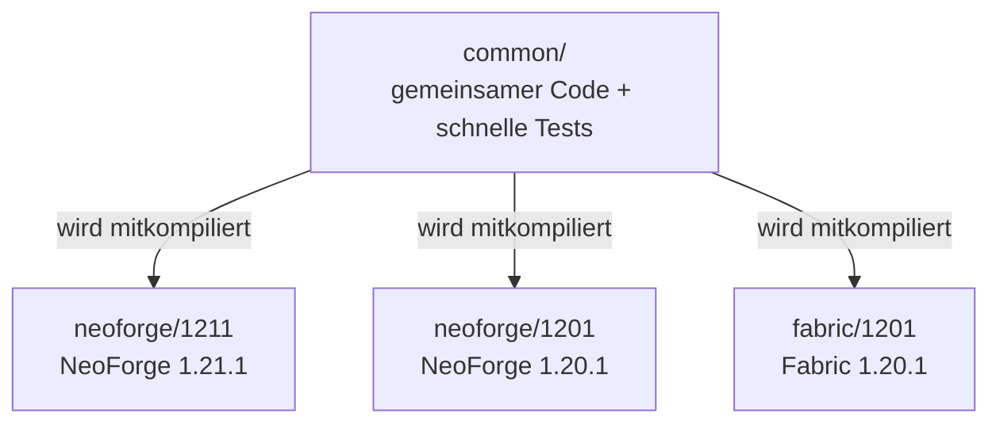

# Create Photomovement — Architekturdokumentation (arc42)

Stand: 2026-11-16, Mod-Version 0.4.0.

Dieses Dokument beschreibt, **wie das Projekt aufgebaut ist und warum**. Es folgt der
Gliederung von [arc42](https://arc42.org), ist aber bewusst kurz gehalten: ein Kapitel,
das für einen Mod dieser Größe nichts hergibt, besteht aus einem Satz.

Was hier **nicht** steht:

| Thema | Steht in |
|---|---|
| Was der Mod für Spieler tut | [README.md](../../README.md) |
| Was sich von Version zu Version geändert hat | [CHANGELOG.md](../../CHANGELOG.md) |
| Behobene Fehler und ihre Ursachen | [docs/bugs.md](../bugs.md) |
| Aktueller Arbeitsstand, Notizen, Wissenssammlung | [docs/Current-Dev-Status.md](../Current-Dev-Status.md) |
| Aufbau und Stand der In-Game-Tests | [docs/gametests.md](../gametests.md), [docs/test-world.md](../test-world.md) |

---

## 1. Einführung und Ziele

Create Photomovement ist ein Addon für den Minecraft-Mod **Create**. Es fügt
Drehkraftquellen hinzu, die von der Sonne angetrieben werden: vier Arten von
Solargeneratoren und ein Windmühlenlager mit Solarsegeln.

Die wichtigsten Ziele, in dieser Reihenfolge:

1. **Gleiches Verhalten auf allen Zielen.** Ein Generator soll unter NeoForge 1.21.1,
   NeoForge 1.20.1 und Fabric 1.20.1 dieselbe Drehzahl liefern.
2. **Wartbar für eine Person.** Das Projekt wird von einem einzelnen Autor gepflegt.
   Fehler sollen früh und verständlich auffallen, nicht erst im Spiel.
3. **Nah an Create.** Die Blöcke sollen sich wie Create-Blöcke anfühlen (Ponder-Szenen,
   Stress-Anzeige, Färben).

## 2. Randbedingungen

| Randbedingung | Auswirkung |
|---|---|
| Drei Ziele: NeoForge 1.21.1, NeoForge 1.20.1, Fabric 1.20.1 | Jedes Ziel ist ein eigenes Gradle-Projekt mit eigenem Build-Plugin. |
| Zwei Java-Versionen: 21 für 1.21.1, 17 für 1.20.1 | Auf dem Entwicklungsrechner und in der CI müssen beide JDKs installiert sein. |
| Create-Version je Ziel verschieden: 6.0.10 (1.21.1), 6.0.8 (NeoForge 1.20.1), 6.0.8.1 (Fabric) | Create-Klassen heißen teils anders oder haben andere Methoden. |
| Minecraft hat zwischen 1.20.1 und 1.21.1 Methoden und Ordnernamen geändert | Manche Klassen und alle Daten-Ordner (`recipe` gegen `recipes` usw.) gibt es pro Version. |
| Lizenz MIT | Keine Einschränkung für den Aufbau. |

Die genauen Versionsnummern stehen in den `gradle.properties` der Ziele, nicht hier.

## 3. Kontext und Umfang

Der Mod läuft im Spiel und hängt an diesen fremden Bausteinen:

| Nachbar | Wofür |
|---|---|
| Minecraft + Loader (NeoForge / Fabric) | Startet den Mod, liefert Blöcke, Welt, Wetter, Tageszeit. |
| Create | Das Drehkraft-System (Drehzahl, Stress), Windmühlenlager, Segel, Config-Grundgerüst. |
| Registrate | Anmelden der Blöcke und Items beim Spiel. |
| Flywheel | Zeichnen der rotierenden Teile. |
| Ponder | Die Erklär-Szenen im Spiel. |
| Forge Config API Port (nur Fabric) | Macht die Forge-Config-Dateien unter Fabric nutzbar. |

Nach außen liefert das Projekt drei Jar-Dateien, eine pro Ziel.

## 4. Lösungsstrategie

- **Rechnen von Minecraft trennen.** Die eigentliche Logik ("wie viel Drehzahl bei
  dieser Tageszeit und diesem Wetter?") liegt in Klassen ohne jeden Minecraft-Bezug
  (`common/.../logic`). Die lassen sich in Sekunden testen, ohne das Spiel zu starten.
- **Gemeinsamen Code nur einmal schreiben.** Alles, was auf allen drei Zielen gleich
  sein kann, liegt in `common/` und wird von jedem Ziel mitkompiliert
  ([ADR-001](adr/001-gemeinsamer-code-per-srcdir.md)).
- **Den Rest bewusst dreifach halten.** Klassen, die vom Loader oder von der
  Minecraft-Version abhängen, gibt es pro Ziel
  ([ADR-002](adr/002-ein-projekt-pro-ziel.md)).
- **Regeln durch Tests absichern statt durch Disziplin.** Dass in `common/` nichts
  Loader-Spezifisches steht, dass alle Ziele dieselben Blöcke und Übersetzungen haben,
  prüfen Tests bei jedem Build.

## 5. Bausteinsicht

### Ebene 1: die Ordner im Repository

| Ordner | Inhalt |
|---|---|
| `common/` | Code und Ressourcen, die für alle Ziele gelten, und die Tests, die ohne Spiel laufen. |
| `neoforge/1211/`, `neoforge/1201/`, `fabric/1201/` | Je ein Ziel: Loader-abhängiger Code und die Ressourcen, die sich zwischen den Zielen unterscheiden. Die Zahl im Ordnernamen ist die Minecraft-Version ohne Punkte. |
| `docs/` | Dokumentation für Entwickler. |
| `media/` | Icon und Screenshots für die Mod-Seiten (CurseForge, Modrinth). Nicht Teil des Jars. |
| `tools/` | Hilfsskripte, siehe [tools/README.md](../../tools/README.md). |
| `.github/` | CI-Abläufe und Arbeitsregeln für KI-Assistenten. |

### Ebene 2: der Code in `common/`

| Paket | Aufgabe |
|---|---|
| `logic` | Reine Rechenklassen ohne Minecraft: `DayCycle` (Tageszeit), `Weather`, `SolarFacing`, `SolarGeneratorOutput`, `HorizontalSolarOutput`, `WindmillOutput`. |
| `content/kinetics/solargenerator` | Die Block-Entities und Renderer der Generatoren, soweit sie auf allen Zielen gleich sind. `SolarFacings` übersetzt Minecrafts Himmelsrichtung in die der Rechenklassen. |
| `infrastructure/config` | `PMServer`: die einstellbaren Werte (Drehzahl, Stress-Kapazität). |
| `gametest` | Gemeinsame Prüfhilfen für die In-Game-Tests (`SolarAssertions`, `WindmillAssertions`). |

### Ebene 2: die Ressourcen

Beim Bauen legt Gradle zwei Ordner übereinander: `common/src/main/resources` und
`<ziel>/src/main/resources`. Im Jar ist nicht mehr zu sehen, woher eine Datei kam.

| Ort | Was dort liegt |
|---|---|
| `common/src/main/resources` | Alles, was auf allen drei Zielen Byte für Byte gleich ist: alle Blockstates, fast alle Modelle und Texturen, die deutsche und spanische Übersetzung, die meisten Ponder-Szenen. 300 Dateien. |
| `<ziel>/src/main/resources` | Was vom Loader abhängt (`mods.toml`, `fabric.mod.json`), was von der Minecraft-Version abhängt (der ganze `data/`-Ordner mit Rezepten, Loot-Tabellen, Tags) und einzelne Dateien, die sich heute zwischen den Zielen unterscheiden (siehe Kapitel 11, Nr. 1). |

**Regel:** Eine Datei liegt entweder in `common/` oder in den Zielen, nie in beiden.
Der Test `CommonResourcesTest` prüft das. Wer ein Modell ändern will, sucht zuerst in
`common/`; liegt es dort, gilt die Änderung für alle drei Ziele.

### Ebene 2: der Code in jedem Ziel

Jedes Ziel hat dieselben rund 22 Klassen, jeweils in eigener Fassung:

| Gruppe | Klassen | Warum pro Ziel |
|---|---|---|
| Anmeldung | `AllBlocks`, `AllItems`, `AllBlockEntityTypes`, `AllContraptionTypes`, `AllCreativeTabs` | Jeder Loader meldet Inhalte anders an. |
| Einstieg | `CreatePhotomovement`, `CreatePhotomovementClient` | Startpunkt des Mods, komplett Loader-Sache. |
| Config-Anbindung | `PMConfigs` | Drei verschiedene Config-Schnittstellen. |
| Blöcke | `SolarGeneratorBlock`, `AdvSolarGeneratorBlock`, die horizontalen Varianten, `SolarSailBlock`, `SolarWindmillBearingBlock` | Die Methode für Rechtsklick heißt in 1.21.1 anders; außerdem hängen sie an der Form von `AllBlocks`. |
| Block-Entities mit Speichern | `HorizontalSolarGeneratorBlockEntity`, `SolarWindmillBearingBlockEntity`, `SolarBearingContraption` | Speichern und Laden hat in 1.21.1 einen zusätzlichen Parameter. |
| Ponder | `PhotomovementPonderPlugin` und drei Szenen-Klassen | Hängen an der Form von `AllBlocks`. |
| In-Game-Tests | `SolarWindmillGameTests` (alle Ziele); `SolarGeneratorGameTests`, `HorizontalSolarGameTests` (nur 1.21.1) | Jeder Loader startet Tests anders. |

Die vollständige Herleitung, welche Klasse aus welchem Grund wo liegt, steht in
[docs/common-code-analysis.md](../common-code-analysis.md).

## 6. Laufzeitsicht

Der wichtigste Ablauf — ein Generator bestimmt seine Drehzahl:

1. Minecraft ruft einmal pro Tick die Block-Entity des Generators auf (nur auf dem Server).
2. Die Block-Entity liest aus der Welt: Tageszeit, Wetter, Himmelslicht über dem Block,
   bei horizontalen Generatoren zusätzlich Blickrichtung und Hindernisse davor.
3. Sie reicht diese Werte an die Rechenklasse in `logic` weiter und bekommt eine Drehzahl zurück.
4. Hat sich die Drehzahl geändert, meldet sie das an Creates Drehkraft-Netz.

Die Windmühle funktioniert gleich, nur zählt sie zusätzlich beim Zusammenbau die
Solarsegel und normalen Segel (`SolarBearingContraption`).

## 7. Verteilungssicht

| Was | Wo |
|---|---|
| Bauen aller Ziele | `./gradlew build` im Hauptordner, oder `tools/build_mod.ps1` (kopiert die Jars zusätzlich nach `tools/builds/`). |
| Ergebnis | `<ziel>/build/libs/createphotomovement-<loader>-<mc-version>-<mod-version>.jar` |
| CI bei jedem Push | `.github/workflows/build.yml`: erst die schnellen Tests, dann alle drei Ziele bauen. |
| CI bei Pull Requests | `.github/workflows/gametest.yml`: startet pro Ziel einen echten Minecraft-Server und lässt die In-Game-Tests laufen. |
| Versionsnummer | Steht genau einmal, in der `gradle.properties` im Hauptordner. `tools/bump_version.ps1` ändert sie. |

Es gibt keinen eigenen Forge-Build ([ADR-003](adr/003-kein-eigener-forge-build.md)).

## 8. Querschnittliche Konzepte

**Tests in zwei Stufen.**
- *Ohne Spiel* (`./gradlew :common:test`, Sekunden): Rechenlogik, plus Ressourcen-Prüfungen
  über alle drei Ziele (jeweils gemeinsame und eigene Ressourcen zusammen, so wie sie im
  Jar landen) — gültiges JSON, jeder Block hat Item-Modell, Loot-Tabelle und
  englischen Namen, Rezepte sind für ihre Minecraft-Version richtig geformt, jede
  Textur existiert, alle Sprachdateien haben dieselben Schlüssel, die Daten-Ordner
  heißen passend zur Minecraft-Version, und in `common/` steht kein Loader-Import.
- *Im Spiel* (GameTests, Minuten): alles, was eine echte Welt braucht — Himmelssicht,
  Verdeckung, Zusammenbau der Windmühle.

**Konfiguration.** Die Werte stehen in `PMServer` (gemeinsam). `PMConfigs` (pro Ziel)
hängt sie an das Config-System des jeweiligen Loaders.

**Übersetzungen.** Englisch, Deutsch, Spanisch als `lang/*.json`. Deutsch und Spanisch
liegen in `common/`, Englisch noch in jedem Ziel (Kapitel 11, Nr. 1). Ein Test
stellt sicher, dass keine Sprache einen Schlüssel auslässt.

**Unterschiede zwischen den Minecraft-Versionen in den Daten.** 1.21.1 benutzt
Einzahl-Ordner (`recipe`, `loot_table`, `structure`, `tags/block`), 1.20.1 Mehrzahl
(`recipes`, `loot_tables`, ...). Rezepte nennen ihr Ergebnis in 1.21.1 `"id"`, in 1.20.1
`"item"`. Beispiele dazu in [docs/Current-Dev-Status.md](../Current-Dev-Status.md).

## 9. Architekturentscheidungen

| Nr. | Entscheidung |
|---|---|
| [ADR-001](adr/001-gemeinsamer-code-per-srcdir.md) | Gemeinsamer Code wird als Quellordner eingebunden, nicht als eigene Bibliothek. |
| [ADR-002](adr/002-ein-projekt-pro-ziel.md) | Ein Gradle-Projekt pro Loader und Minecraft-Version; loader- und versionsabhängige Klassen gibt es dreifach. |
| [ADR-003](adr/003-kein-eigener-forge-build.md) | Kein eigener Forge-Build. |

Entscheidungen zum *Verhalten* (z. B. "Glas blockiert die Sonne nicht") stehen als E1–E6
in [docs/common-code-analysis.md](../common-code-analysis.md).

## 10. Qualitätsanforderungen

| Ziel | Woran man es misst |
|---|---|
| Gleiches Verhalten auf allen Zielen | Die Rechenlogik existiert nur einmal; In-Game-Tests laufen in der CI gegen alle drei Ziele. |
| Fehler fallen früh auf | Die Tests ohne Spiel laufen in der CI vor dem Bauen und brauchen Sekunden. |
| Kein Ziel wird vergessen | Ressourcen-Tests vergleichen die drei Ziele miteinander. |

## 11. Risiken und technische Schulden

| # | Schuld | Folge | Möglicher Ausweg |
|---|---|---|---|
| 1 | **Acht Asset-Dateien unterscheiden sich zwischen den Zielen, vermutlich ungewollt.** Fabric hat eigene Fassungen von `lang/en_us.json` (andere Texte in der ersten Ponder-Szene), der vier Grundmodelle der Generatoren (`models/block/solar_generator.json` usw., ein Maß 15 statt 16) und von `textures/block/adv_solar_generator_top.png`. `solar_generator_top.png` ist nur in NeoForge 1.21.1 anders. Dazu fehlen einzelne Ponder-Vorlagen je Ziel (`basics.nbt`, `horizontalsolgendir.nbt`). | Die Generatoren können je nach Ziel leicht anders aussehen oder andere Texte zeigen. | Im Spiel vergleichen, eine Fassung festlegen und nach `common/` verschieben. Bis dahin liegen diese Dateien in jedem Ziel. |
| 1a | **Daten liegen pro Ziel**, obwohl die beiden 1.20.1-Ziele vermutlich dieselben Rezepte und Loot-Tabellen haben. | Rezeptänderungen müssen dreimal gemacht werden. | Ein gemeinsamer Ordner nur für 1.20.1 wäre möglich, lohnt aber erst bei häufigen Änderungen. |
| 1b | **`models/block/horizontal_solar_generator copy.json`** ist eine liegengebliebene Kopie (jetzt in `common/`). Minecraft lädt Dateien mit Leerzeichen im Namen nicht. | Keine, nur Ballast. | Löschen. |
| 2 | **Die Form von `AllBlocks` unterscheidet sich.** NeoForge liefert Verpackungen (`AllBlocks.X.get()`), Fabric direkte Blöcke (`AllBlocks.X`). | Vier Klassen (drei Ponder-Szenen, `AllBlockEntityTypes`) sind nur deshalb dreifach. | Umbau von `AllBlocks`/`AllItems`, siehe [common-code-analysis.md](../common-code-analysis.md). |
| 3 | **In-Game-Tests sind ungleich verteilt.** `SolarGeneratorGameTests` und `HorizontalSolarGameTests` gibt es nur für 1.21.1. | Auf den 1.20.1-Zielen sind die Generatoren im Spiel nicht automatisch geprüft. | Die Tests auf die anderen Ziele übertragen; die gemeinsamen Prüfhilfen liegen schon in `common/.../gametest`. |
| 4 | **Build-Dateien der Ziele ähneln sich, sind aber getrennt.** | Listen von Paketquellen können auseinanderlaufen. | Geringe Priorität; die drei Build-Plugins sind zu verschieden für eine gemeinsame Datei. |
| 5 | **`docs/code-documentation-1211.md` ist veraltet** (Februar 2026, beschreibt den Stand vor `common/`). | Kann in die Irre führen. | Als Lernhilfe behalten oder neu schreiben. |

## 12. Glossar

| Begriff | Bedeutung |
|---|---|
| Loader | Das Programm, das Mods in Minecraft lädt: NeoForge, Forge oder Fabric. |
| Ziel (Target) | Eine Kombination aus Loader und Minecraft-Version, für die ein Jar gebaut wird. |
| Block-Entity | Der Teil eines Blocks, der sich etwas merken und jeden Tick etwas tun kann. |
| SU (Stress Units) | Creates Maß dafür, wie viel Last eine Drehkraftquelle tragen kann. |
| RPM | Umdrehungen pro Minute. |
| Contraption | Ein in Create zusammengebautes bewegliches Gebilde, hier die Windmühle mit ihren Segeln. |
| Ponder | Creates Erklär-Szenen im Spiel. |
| GameTest | Minecrafts eingebautes System für Tests in einer echten Welt. |
| Headless-Test | Ein Test, der ohne Minecraft läuft. |
| Drift | Zwei Kopien derselben Datei, die ohne Absicht auseinandergelaufen sind. |
| ADR | Architecture Decision Record: eine kurze Notiz, was entschieden wurde und warum. |
